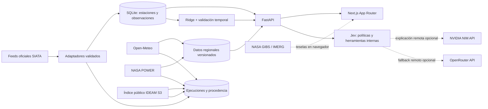

# SIATA Intelligence

Plataforma de inteligencia ambiental para el Valle de Aburrá. Reúne observaciones de estaciones SIATA, pronósticos de modelo con procedencia explícita, análisis reproducibles y una interfaz Next.js para explorar estaciones, mapas, fuentes, operaciones y modelos.

> Cada dato conserva su fuente, hora válida y escala. Los pronósticos de grilla y los análisis regionales nunca se presentan como mediciones de una estación SIATA.

## Capacidades

- Ingesta periódica y deduplicada de feeds públicos SIATA con validación de esquema, reintentos y registro de ejecuciones.
- Consulta de estaciones, series, frescura, eventos y análisis desde FastAPI.
- Pronóstico regional de Open-Meteo guardado por versión de captura y separado de observaciones.
- Análisis meteorológico diario NASA POWER, normalizado con unidades y coordenadas devueltas por el proveedor.
- Catálogo de metadatos de archivos de radar IDEAM; los volúmenes RAW no se descargan ni se interpretan.
- Visualización bajo demanda de capas NASA GIBS: IMERG Early y MODIS Terra True Color.
- Modelo Ridge autoregresivo por estación para PM2.5, con validación temporal y baseline de persistencia; un candidato solo se promueve si lo supera.
- Jev combina reglas deterministas auditables con evidencia de SIATA, pronósticos y análisis. NVIDIA NIM se consulta por API remota para explicar esa evidencia; OpenRouter es un proveedor remoto alternativo.
- Ciclos independientes para SIATA, fuentes externas y selección automática de modelos, con checkpoints y leases persistidos en la base de datos.
- Verificación de disponibilidad de endpoints SIATA una vez al día en una tarea aislada, para que un probe lento no bloquee la ingestión de estaciones.

## Arquitectura



La base SQLAlchemy usa SQLite por defecto. Las tablas `observations` y `regional_data` tienen propósitos distintos; las fuentes externas no se mezclan en el repositorio de mediciones SIATA. Las decisiones de Jev, ejecuciones y leases se registran para inspección y reintentos.

## Fuentes y cobertura

| Fuente | Integración | Uso y límite |
|---|---|---|
| SIATA | Ingesta automatizada | Sensores y variables presentes en los feeds verificados; algunos feeds de lluvia/nivel solo incluyen hora de captura. |
| Open-Meteo | Pronóstico horario regional, cada 3 h | Celda/modelo Best Match devuelto por el proveedor, hasta 3 días. No es pronóstico oficial SIATA. |
| NASA POWER | Datos diarios regionales | Ventana móvil con margen de publicación de 2 días; resolución meteorológica aproximada de 0.5° × 0.625°. No representa una estación local. |
| NASA GIBS / GPM IMERG Early | Teselas visuales bajo demanda | IMERG 30 min y aproximadamente 0.1°; el color de la tesela no se convierte en un valor de ML. |
| IDEAM Radar S3 | Índice de metadatos cada 6 h | Lista volúmenes disponibles en la ventana reciente. El archivo tiene retraso y no es un feed operativo de nowcasting. |
| Copernicus CDS / NOAA NCEI | No integradas | Se muestran como candidatas, sin fingir cobertura, credenciales ni series locales validadas. |

Las coordenadas de consulta regional se calculan a partir de la mediana de estaciones activas SIATA geolocalizadas. La respuesta registra las coordenadas reales de celda devueltas por cada proveedor. Si no hay al menos tres estaciones con coordenadas válidas, el conector falla con un estado visible en lugar de usar un punto inventado.

## Frontend

Next.js App Router, React, TypeScript y Tailwind CSS. El diseño usa una paleta monocromática, componentes accesibles, TanStack Query para caché y Apache ECharts/Leaflet cargados en componentes interactivos.

| Ruta | Función |
|---|---|
| `/` | Dashboard, indicadores con hora, series SIATA y pronóstico externo separado. |
| `/stations` | Búsqueda, filtros y mapa de estaciones. |
| `/stations/[stationId]` | Detalle, mediciones e histórico de estación. |
| `/models` | Métricas y versiones ML disponibles. |
| `/assistant` | Consultas a Jev respaldadas por herramientas y datos del backend. |
| `/sources` | Catálogo, estado de conectores, ejecuciones y límites de datos. |
| `/satellite` | Mapa de teselas NASA GIBS e inventario SIATA geolocalizado. |
| `/operations` | Historial de decisiones de Jev y ejecuciones programadas. |

La capa API está en `frontend/lib/api.ts`; los hooks TanStack están en `frontend/lib/hooks/`. El proxy de Next.js envía `/api/*` al backend usando una variable de servidor. La interfaz incluye estados de carga, error y ausencia de datos; no usa métricas de relleno.

## Machine Learning y Jev

El modelo disponible es un Ridge autoregresivo para PM2.5 por estación, con rezagos horarios 1, 2 y 24, media móvil de seis horas y validación cronológica sobre un segmento continuo. Exige al menos 72 puntos horarios consecutivos y registra MAE, RMSE y R² cuando corresponde. La predicción compara contra persistencia; un candidato que no la supera no se promueve. El intervalo derivado del error no es una garantía calibrada para extremos.

La tarea automática explora hasta ocho estaciones con suficientes observaciones recientes. La calidad y continuidad se validan durante entrenamiento. No existe todavía modelo entrenado de lluvia ni fusión de pronóstico externo con sensores SIATA: hacen falta series locales pareadas y suficientes para validación temporal sin leakage.

Jev usa un motor de decisión determinista y tipado para habilitar ingestas y aceptar modelos. La solicitud especifica Typesafe, pero esta copia del proyecto no contiene SDK, URL de servicio ni contrato de petición/respuesta; por eso el proveedor figura como no disponible y no se inventa una integración. Cuando `NVIDIA_API_KEY` está configurada, las explicaciones se envían a NVIDIA NIM en `integrate.api.nvidia.com`; si no, puede usarse OpenRouter cuando tenga credenciales. Sin proveedor configurado, responde el resumen determinista de la evidencia. La clave permanece en el backend. No se instalan pesos, CUDA, PyTorch ni contenedores NIM locales. La pregunta del usuario y un resumen de evidencia se envían al proveedor remoto; no incluyas datos sensibles.

La integración NIM solo resume datos consultados por las herramientas del proyecto: no crea mediciones ni pronósticos. Aunque NVIDIA ofrece endpoints climáticos, CorrDiff está entrenado para el territorio continental de EE. UU. y la API pública de FourCastNet documenta muestras de entrada predefinidas. No se usan para afirmar pronósticos para Medellín.

## Requisitos e instalación local

- Python 3.10+ y acceso de red a las fuentes públicas.
- Node.js compatible con Next.js 16.
- NVIDIA NIM y OpenRouter son opcionales y requieren credenciales para explicaciones remotas. NASA POWER, Open-Meteo, GIBS e IDEAM no requieren credenciales para las operaciones implementadas.
- No se requiere GPU ni runtime de deep learning local. El único modelo local actual es Ridge de scikit-learn, un baseline CPU liviano.

```powershell
python -m venv .venv
.\.venv\Scripts\Activate.ps1
python -m pip install -r requirements.txt
Copy-Item .env.example .env
Copy-Item frontend/.env.local.example frontend/.env.local
```

Terminal 1, raíz del proyecto:

```powershell
uvicorn backend.main:app --host 127.0.0.1 --port 8000
```

Terminal 2:

```powershell
cd frontend
npm ci
npm run dev
```

Abre `http://127.0.0.1:3000`; FastAPI sirve `/docs` en `http://127.0.0.1:8000/docs`. La aplicación crea las tablas nuevas al iniciar. SIATA y los conectores externos se ejecutan de forma independiente; si una fuente falla, sus errores y reintentos no detienen las demás.

## Configuración

Las variables completas y valores seguros están en `.env.example` y `frontend/.env.local.example`.

| Variable | Uso |
|---|---|
| `DATABASE_URL` | SQLAlchemy; por defecto SQLite local bajo `data/`. |
| `SIATA_SYNC_ENABLED`, `SIATA_SYNC_INTERVAL_SECONDS` | Ciclo SIATA, por defecto 300 s. |
| `SIATA_DISCOVERY_ENABLED`, `SIATA_DISCOVERY_INTERVAL_SECONDS` | Escaneo de endpoints, por defecto diario y con timeouts acotados. |
| `OPEN_METEO_SYNC_ENABLED`, `OPEN_METEO_SYNC_INTERVAL_SECONDS` | Pronóstico externo, por defecto 10 800 s. |
| `NASA_POWER_SYNC_ENABLED`, `NASA_POWER_SYNC_INTERVAL_SECONDS` | Análisis diario, por defecto 86 400 s. |
| `IDEAM_RADAR_CATALOG_ENABLED`, `IDEAM_RADAR_CATALOG_INTERVAL_SECONDS` | Catálogo de metadatos, por defecto 21 600 s. |
| `SIATA_AUTO_ML_ENABLED`, `SIATA_AUTO_ML_INTERVAL_SECONDS` | Selección de modelos, por defecto 21 600 s. |
| `NVIDIA_API_KEY`, `NVIDIA_MODEL` | Explicación remota con NVIDIA NIM; la API key solo se lee en el backend. Modelo por defecto: `nvidia/nemotron-3.5-bolt-e4b`. |
| `OPENROUTER_API_KEY`, `OPENROUTER_MODEL` | Proveedor remoto alternativo cuando no se configuró NVIDIA; nunca se exponen al navegador. |
| `SIATA_BACKEND_URL` | Destino server-side del proxy Next.js. |

Cada ciclo puede deshabilitarse con `false`. No se requieren credenciales Typesafe: el proveedor permanece señalado como no disponible hasta que exista un contrato verificable.

## API principal

| Método | Ruta | Descripción |
|---|---|---|
| GET | `/api/health` | Estado del servicio y frescura. |
| GET | `/api/stations`, `/api/stations/{id}` | Inventario y detalle. |
| GET | `/api/observations/latest`, `/api/observations/timeseries` | Observaciones SIATA. |
| GET | `/api/freshness`, `/api/events` | Disponibilidad y eventos. |
| GET | `/api/sources`, `/api/sources/gibs` | Catálogo y metadatos disponibles de capas. |
| GET | `/api/regional/forecast`, `/api/regional/history` | Pronósticos y análisis regionales con procedencia. |
| GET | `/api/jev/decisions` | Auditoría de políticas. |
| GET/POST | `/api/ml/models`, `/api/ml/train`, `/api/ml/forecast`, `/api/ml/anomalies` | Entrenamiento y análisis ML. |
| POST | `/api/agent/query` | Preguntas a Jev con evidencia del proyecto. |
| POST | `/api/ingestion/sync` | Sincronización SIATA manual. |

## Verificación

Backend, desde la raíz:

```powershell
python -m compileall -q backend tests
python -m unittest discover -s tests -v
```

Frontend, desde `frontend/`:

```powershell
npm run lint
npm run typecheck
npm run build
```

Las pruebas unitarias usan SQLite en memoria y fixtures locales. `test_platform.py` es una integración manual con fuentes externas; puede escribir datos y archivos crudos, así que no forma parte de la batería offline.

## Estructura

```text
backend/
  agent/              Jev, herramientas, políticas y APIs de explicación remota
  api/                Rutas y contratos HTTP
  database/           SQLAlchemy, modelos y persistencia
  ingestion/          Adaptadores SIATA y conectores regionales
  ml/                 Pronóstico y análisis ambiental
  services/           Scheduler, catálogo, GIBS y AutoML
frontend/
  app/                Rutas, layouts y estados globales
  components/         Dashboard, estaciones, mapas, ML, fuentes y asistente
  lib/                Cliente API, tipos, utilidades y hooks
tests/                Pruebas unitarias offline
data/                 Base SQLite y archivos locales ignorados por Git
```

## Límites conocidos

- No hay interpolación espacial: los puntos de estaciones y teselas conservan sus escalas originales.
- Las capturas de feeds SIATA que no traen hora de observación no se presentan como tasas actuales ni se usan en análisis temporales.
- El modelo local cubre PM2.5; faltan continuidad y etiquetas meteorológicas para entrenar y evaluar un modelo de precipitación propio.
- La capa IMERG de GIBS es solo visual; la ingestión de datos cuantitativos GPM requeriría configurar acceso a productos científicos y validar su uso.
- IDEAM se consulta como archivo de metadatos retrasado, no como radar en vivo; no se decodifican volúmenes RAW.
- Typesafe no está conectado porque el proyecto no aporta endpoint ni contrato de integración.
- La explicación NVIDIA necesita una `NVIDIA_API_KEY` válida. Sin ella, Jev usa OpenRouter si está configurado o su resumen determinista; no hay inferencia de lenguaje local.
